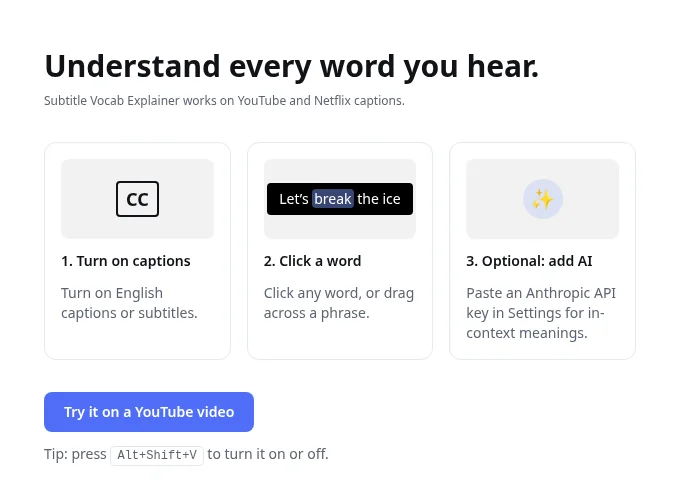
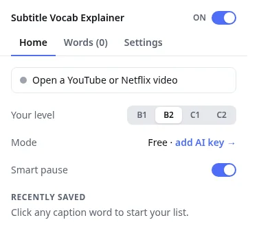

# Subtitle Vocab Explainer

A Chrome (Manifest V3) extension that explains words and idioms in **YouTube** and **Netflix** captions. Click a word, and see what it means *in this scene* without leaving the video.

- **Smart pause:** pauses while you look something up, resumes only if it paused.
- **Idioms first:** idioms and phrasal verbs are underlined; drag across any phrase to explain it.
- **Free Mode** (no key): dictionary definition, IPA, pronunciation, estimated level.
- **AI Mode** (optional Anthropic key): the meaning in the current line, at your level (B1–C2).
- **Yours to keep:** unlimited saved words, CSV export, no account.

<table><tr>
<td width="62%"></td>
<td width="38%"></td>
</tr><tr><td align="center"><sub>Onboarding</sub></td><td align="center"><sub>Popup</sub></td></tr></table>

> **Status:** M0–M8 are implemented. Typecheck, 237 unit tests across 22 files, and the production build all pass. The manual demo script and polish checklist still need a hands-on pass in Chrome. The PRD, competitor analysis, UX spec, technical design and milestone plan are in [`docs/`](docs/).

## Documents

| # | Document | What it answers |
|---|---|---|
| 01 | [Product requirements](docs/01-PRD.md) | What's in scope, what's out, success criteria |
| 02 | [Competitor analysis](docs/02-competitor-analysis.md) | Who else exists and how we beat them |
| 03 | [UX / UI spec](docs/03-ux-ui-spec.md) | Exactly how it looks and behaves |
| 04 | [Technical design](docs/04-technical-design.md) | Architecture, types, algorithms, prompts, tests |
| 05 | [Implementation tasks](docs/05-implementation-tasks.md) | Milestones M0–M8 with acceptance criteria |
| 06 | [Demo and deployment](docs/06-demo-and-deployment.md) | Load it in Chrome, demo script, troubleshooting, CI/Web Store |

## Quickstart

```bash
npm install
npm run build
```

Then open `chrome://extensions` → enable **Developer mode** → **Load unpacked** → select `dist/`. Full steps and the demo script are in [06](docs/06-demo-and-deployment.md).

## Scripts

| Command | Purpose |
|---|---|
| `npm run dev` | Dev server with hot reload |
| `npm run typecheck` | TypeScript check |
| `npm test` | Unit tests (Vitest) |
| `npm run build` | Production build into `dist/` |
| `npm run zip` | Build and create `release/vocab-explainer-<version>.zip` |

## Engineering highlights
- Caption DOM adapters for YouTube and Netflix, with an idiom and phrasal-verb matcher, lemmatisation and CEFR level estimates
- A content-script card rendered in a closed Shadow DOM, with viewport-aware placement and smart pause/resume
- A typed message router in the MV3 service worker, response caching, and an LLM service that never leaks the API key (covered by tests)
- CI on GitHub Actions: typecheck, test and build, a check that refuses any build with an embedded key, and packaging

## Stack

Vite 6 + `@crxjs/vite-plugin`, TypeScript (strict), React 18 + Tailwind 3 (popup), plain TS content script with a closed Shadow DOM card, `@anthropic-ai/sdk` in the service worker, Vitest.

## Privacy

Your API key (if you add one) is stored only in this browser and sent only to the host configured in `src/shared/apiConfig.ts`. A demo build can embed a key (see docs/06); that key is readable by anyone who has the build, so such builds are never zipped. Looked-up words are sent to `dictionaryapi.dev`, and, in AI Mode, with the surrounding caption line to Anthropic. No analytics, no telemetry.
